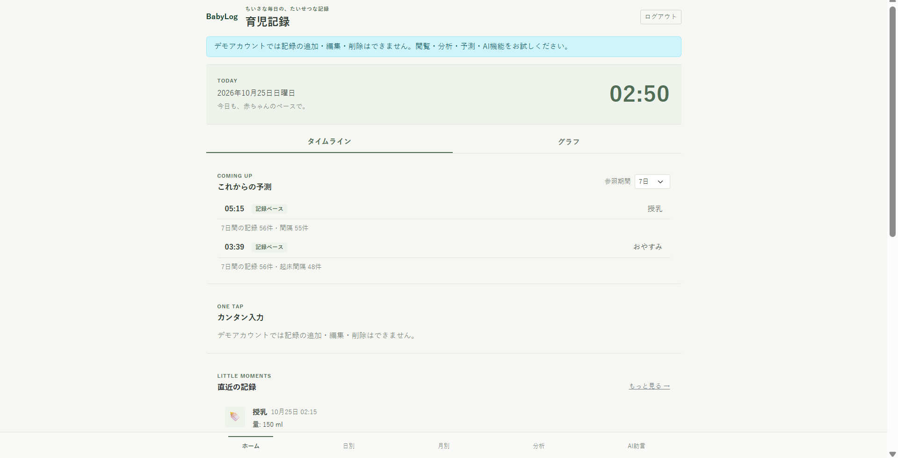
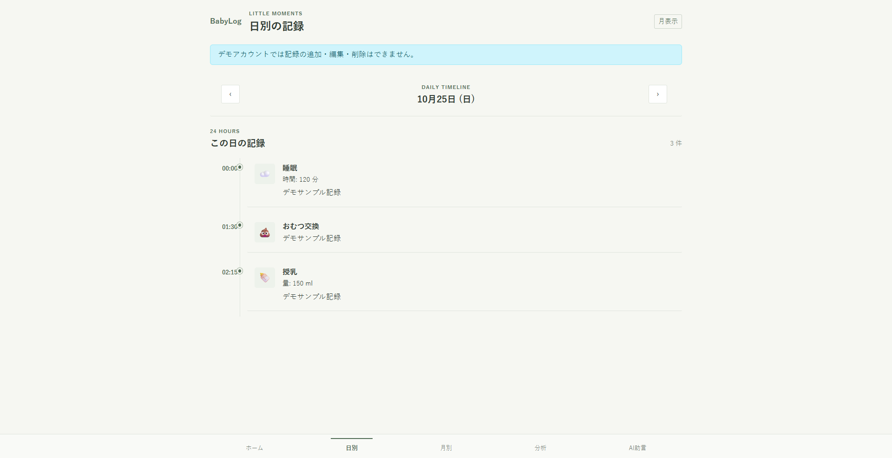
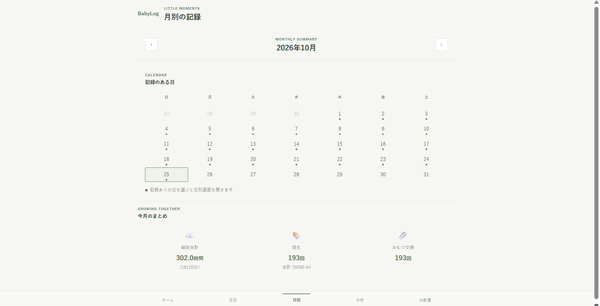
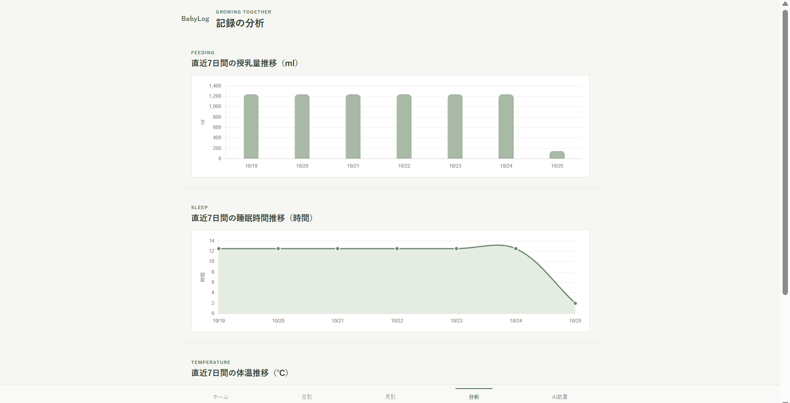
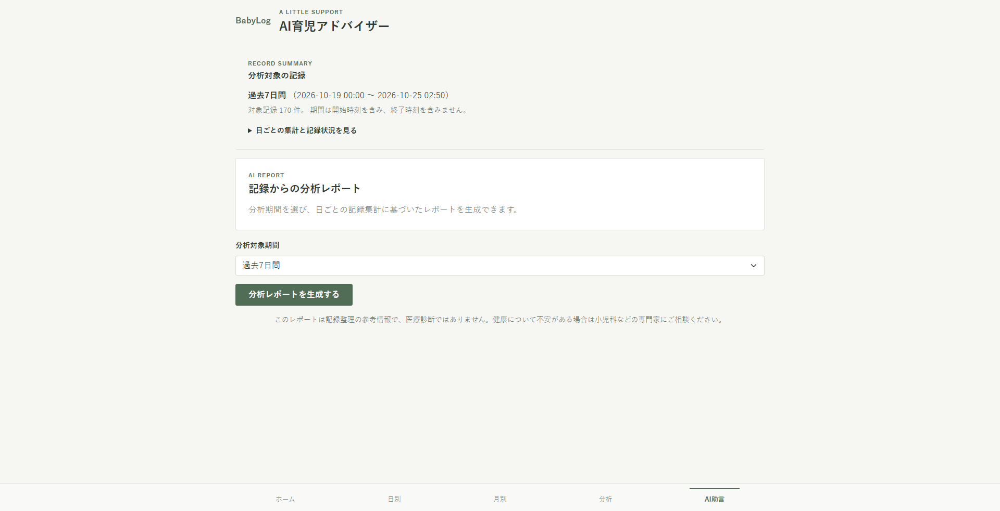
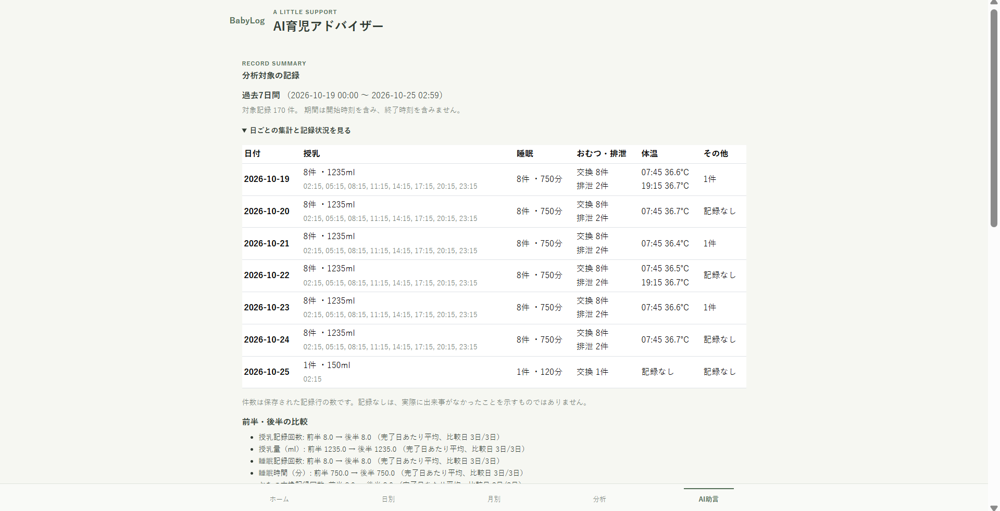
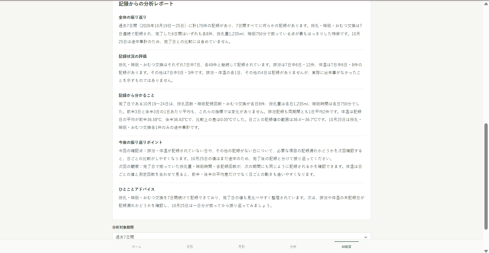

# app1_public

## プロジェクト概要

BabyLogは、授乳・睡眠・おむつ交換などの育児記録を登録し、日々の記録を振り返るためのWebアプリです。記録の閲覧や集計を通じて、育児の記録を整理しやすくすることを目指して開発しました。

## 画面紹介

### TOP画面

記録の登録や最近の記録、予測を確認できます。



### 日別画面

日ごとの育児記録を確認できます。



### 月別画面

月単位で記録を振り返る画面です。



### 分析画面

授乳量・睡眠時間・体温の推移をグラフで確認できます。



### AI助言

分析画面からAIアドバイスを生成します。AI機能の利用条件は「AI機能について」を参照してください。



生成結果の画面です。





## 主な機能

- ユーザー登録、ログイン、ログアウト
- 授乳、睡眠、おむつ交換、排泄、体温、その他の記録の登録・編集・削除
- 記録の一覧、日別・月別表示
- 直近の記録に基づく授乳・睡眠時刻の予測
- 授乳量・睡眠時間・体温の週次グラフと、期間別の分析
- 集計データをもとにしたAIアドバイス
- 架空のサンプル記録を閲覧できる読み取り専用デモアカウント

## 使用技術

- Python、Django
- SQLite（アプリの記録データ保存）
- Docker、Docker Compose
- Requests（AI APIとの通信）
- Bootstrap 5、Chart.js

## 開発で工夫した点

- 記録をユーザーに紐づけ、閲覧・編集・削除を本人の記録に限定しています。
- 予測は選択した期間の記録間隔を利用し、十分な記録がない場合は標準間隔を使います。予測は参考情報です。
- AIには個々の記録一覧やメモではなく、選択期間の日別集計を送信します。送信データのサイズや一部のサンプル数にも上限を設けています。
- デモアカウントは記録の変更をサーバー側でも拒否し、通常ユーザーの記録と分離しています。
- テストではAI API呼び出しをモックし、テスト中に外部APIへ通信しないようにしています。

## 起動方法

### 必要な環境

- Docker
- Docker Compose

### 手順

リポジトリのルートで以下を実行します。

```sh
cp .env.example .env
```

`.env` の `DJANGO_SECRET_KEY` と `POSTGRES_PASSWORD` を、それぞれ別のランダムな値に置き換えてください。デモアカウントを表示する場合は `DEMO_ACCOUNTS_ENABLED=true` にします。秘密情報をREADMEやGitに記載・登録しないでください。

```sh
docker compose up --build -d
docker compose exec backend python manage.py migrate
docker compose exec backend python manage.py initialize_demo_accounts
```

起動後、<http://localhost:8000/> を開きます。ログイン画面のデモボタンから、架空のサンプル記録を閲覧できます。

アプリの育児記録はSQLite（`backend/db.sqlite3`）に保存されます。Docker ComposeにはPostgreSQLサービスも含まれ、起動時に `POSTGRES_PASSWORD` が必要ですが、現在のDjango設定はこのPostgreSQLをアプリのデータベースとして使用していません。

## AI機能について

AIアドバイスの利用には、INIADの学生向けAI API環境を利用できることと、API接続先およびAPIキーなどの必要な設定が必要です。設定は `.env` の `AI_API_URL` と `AI_API_KEY` を使います。GitHubから取得しただけではAI機能をすぐに利用できません。利用権限のない方が使える一般公開サービスではありません。APIキーなどの秘密情報はリポジトリに登録しないでください。

AI機能を実行すると、選択期間の日別集計が外部APIへ送信されます。AIの回答は記録の振り返りを支援するもので、医療上の診断や判断を行うものではありません。

## 開発状況・注意事項

このプロジェクトは、学習・開発成果を示すための個人開発ポートフォリオです。公開リポジトリからコードを確認できますが、サービスの継続運用や一般ユーザーへの提供を目的としていません。開発用の設定のため、インターネットに公開して運用する構成ではありません。
